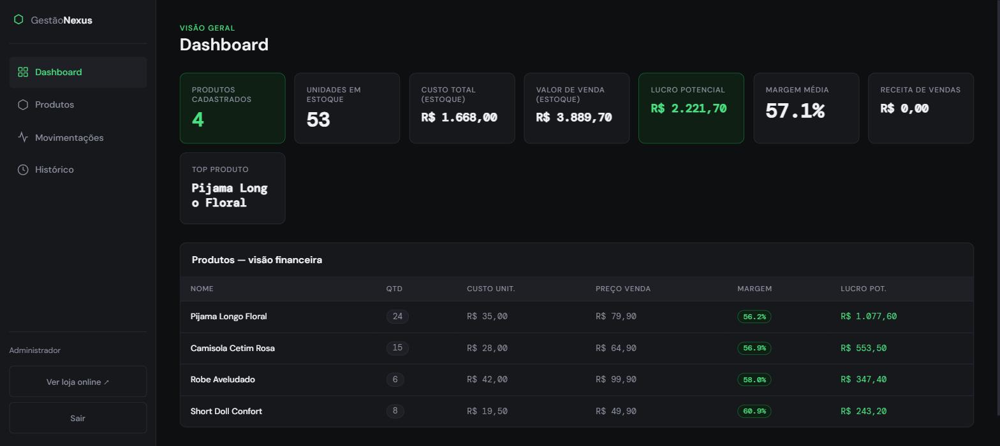
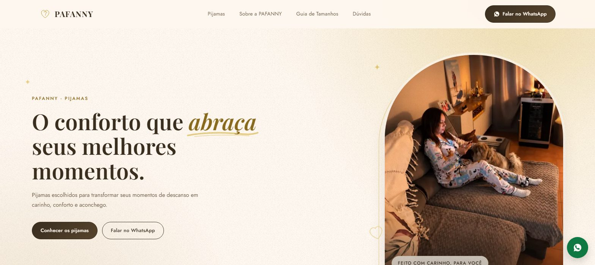
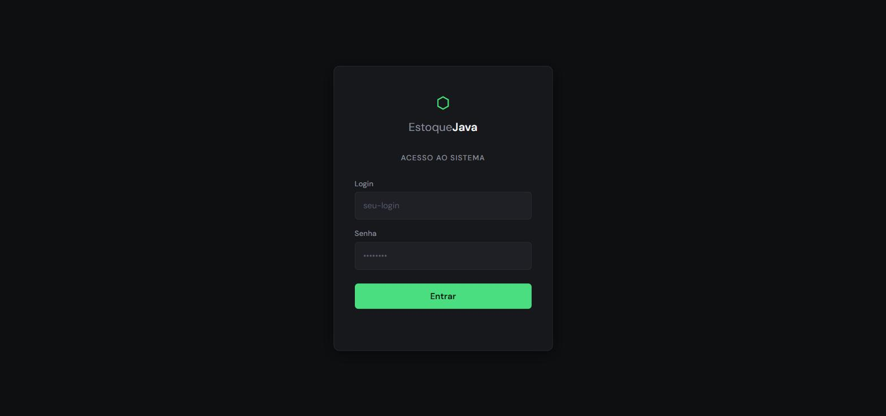

# GestãoNexus

Sistema de estoque que eu construí para a **PAFANNY**, uma loja de pijamas femininos que
vende pelo WhatsApp e pelo Instagram. Ele tem duas caras: um painel interno, onde a loja
cadastra peças, custos, preços e registra cada venda e entrada, e uma vitrine pública
([pafanny.com.br](https://pafanny.com.br)) onde as clientes veem o catálogo e chamam no
WhatsApp com a mensagem da peça já pronta.

Java 21 · Spring Boot 3.2 · Spring Security + JWT · H2 · HTML/CSS/JS sem build · Railway

| Painel | Vitrine | Login |
|:---:|:---:|:---:|
|  |  |  |

## Por que eu fiz

A loja precisava responder três perguntas sem abrir planilha: o que tem em estoque, quanto
aquilo custou e quanto já vendeu. E precisava de um catálogo bonito para mandar para as
clientes, que não virasse uma loja virtual com carrinho e pagamento, porque a venda acontece
mesmo é na conversa do WhatsApp.

Então o sistema faz as duas coisas com o mesmo banco: a peça cadastrada no painel, marcada
como "visível na loja", aparece na vitrine com foto, preço e um botão que abre o WhatsApp
com nome, estampa, preço e código da peça. Custo e margem nunca saem do painel.

## O que ele faz

- **Produtos** com custo, preço de venda (que pode ficar em branco: a vitrine mostra
  "Consulte o valor"), categoria, estampa, código, fotos e grade de tamanho/cor.
- **Movimentações**: venda, entrada, ajuste e devolução, com histórico e exportação em CSV
  (formatado para abrir direto no Excel em português).
- **Painel financeiro**: valor do estoque a custo e a preço de venda, lucro potencial,
  receita e um gráfico das vendas dos últimos 14 dias.
- **Várias empresas** no mesmo sistema, cada uma com o próprio login e os próprios dados;
  um admin cadastra e desativa empresas.
- **Vitrine** (`/` e `/loja.html`): catálogo, guia de tamanhos, FAQ e o fluxo do WhatsApp.
  Sem JavaScript, a página ainda traz as peças principais em HTML.
- **Backup e restauração** do banco e das fotos pelo painel do admin.
- **PWA**: o painel pode ser instalado no celular como um app.

## Por que fiz assim

**H2 em arquivo, e não um banco "de verdade" desde o início.** A loja tem um volume pequeno
de dados e roda num único servidor. Com o H2 o banco é um arquivo só (`estoque.mv.db`):
não tem servidor de banco para instalar nem para pagar, o backup é um comando (`BACKUP TO`)
que funciona com o sistema no ar, e restaurar é trocar o arquivo. No Railway ele fica num
volume, junto com as fotos. Se um dia precisar de MySQL, é só configurar variáveis de
ambiente (veja abaixo).

**Front sem build.** As páginas são HTML, CSS e JavaScript puros, servidos pelo próprio
Spring Boot. Não existe Node no servidor nem uma segunda pipeline de deploy: um `Dockerfile`
gera um jar e pronto. Para a vitrine, isso também ajudou a manter a página leve. O Node
aparece só na pasta `e2e/`, para os testes, e nunca entra no build.

**Multi-tenant desde o começo.** Cada consulta recebe a empresa logada, então o mesmo
sistema serve mais de uma loja sem misturar dados. Fazer isso no começo custou pouco (uma
coluna `empresa_id` e um parâmetro a mais nos services); adaptar depois seria mexer em tudo.
A vitrine mostra uma empresa só, escolhida pela variável `APP_LOJA_LOGIN`.

**Segredos só por variável de ambiente.** O `application.properties` não tem nenhuma senha
nem chave. Sem `APP_JWT_SECRET` e `APP_ADMIN_SENHA` definidos, a aplicação nem sobe. Preferi
assim a correr o risco de ela subir em produção com um valor padrão esquecido.

## Segurança

O que está implementado e o motivo de cada escolha:

| Prática | Como funciona aqui |
|---|---|
| Sem segredo no código | O `application.properties` só referencia `${VARIAVEIS}`. Para senha e chave JWT não existe valor padrão, de propósito. |
| Falhar em vez de subir inseguro | Sem `APP_JWT_SECRET` ou `APP_ADMIN_SENHA`, o Spring não consegue resolver a propriedade e a aplicação não inicia. |
| Senhas com hash | BCrypt com custo 12 (o padrão é 10). A senha nunca é guardada nem registrada em log. |
| Tokens | JWT assinado (HS256), com expiração de 8 horas por padrão. A empresa é conferida no banco a cada requisição (pelo id, não só pelo login), e o papel de admin vem do banco, não do token. Desativar uma empresa corta o acesso na hora. |
| Login | Senha errada, login inexistente e empresa inativa com senha errada recebem a mesma resposta, no mesmo tempo: não dá para descobrir quais logins existem. |
| Separação entre empresas | Os services recebem a empresa logada e filtram por ela; o catálogo público usa um DTO próprio que não carrega custo nem dados internos. |
| Força bruta no login | Depois de 8 erros do mesmo IP (ou 30 no mesmo login) em 15 minutos, o login responde `429`. A contagem fica em memória e zera quando o servidor reinicia. |
| Erros | Exceções inesperadas viram uma mensagem genérica; o stack trace fica só no log do servidor. |
| Uploads | Só JPEG, PNG e WebP de até 5 MB, salvos com nome aleatório (UUID). Na restauração de backup, caminhos que tentam sair da pasta são recusados e o zip tem limite de tamanho. |
| CSV | Campos que começam com `=`, `+`, `-` ou `@` são neutralizados, para não virarem fórmula ao abrir no Excel. |

## Como rodar

Precisa de **Java 21** e **Maven 3.8+**.

```bash
git clone https://github.com/CodeVinnycius/GestaoNexus-Pafanny.git
cd GestaoNexus-Pafanny
```

Defina as duas variáveis obrigatórias (a lista completa está em
[`application.properties.example`](./application.properties.example)):

```bash
# Linux / macOS
export APP_JWT_SECRET=$(openssl rand -base64 32)
export APP_ADMIN_SENHA="uma-senha-forte-aqui"
```

```powershell
# Windows PowerShell
$env:APP_JWT_SECRET = [Convert]::ToBase64String((1..32 | ForEach-Object { Get-Random -Maximum 256 }))
$env:APP_ADMIN_SENHA = "uma-senha-forte-aqui"
```

```bash
mvn spring-boot:run
```

- `http://localhost:8080/` abre a vitrine;
- `http://localhost:8080/login.html` abre o painel. Entre com `admin` e a senha que você
  definiu, cadastre uma empresa e use o login dela para cadastrar produtos.

No Windows, o `scripts/rodar-loja-local.ps1` sobe tudo com uma **cópia** do banco local e
senhas descartáveis, em `http://localhost:8081`. É o que eu uso para testar antes de
publicar. Os outros scripts estão explicados em [`scripts/README.md`](scripts/README.md).

### Testes

```bash
mvn test
```

Não precisa de variável de ambiente: os testes usam um banco em memória e pastas
temporárias (`src/test/resources/config/`), então nunca encostam no banco de verdade. Eles
passam pela API como o painel usa: separação entre empresas, login, tokens, movimentações
de estoque e o cadastro de empresas.

Os testes da vitrine ficam em `e2e/` (Playwright) e rodam contra o site local, nunca contra
produção: overflow horizontal em 17 tamanhos de tela, página sem JavaScript,
`prefers-reduced-motion`, o link do WhatsApp em todas as peças e um teste com bloqueador de
anúncios de verdade.

```bash
cd e2e && npm install
npx playwright test qualidade whatsapp
```

### Usando MySQL

Nenhuma linha de código muda, só variáveis de ambiente:

```bash
export DB_URL="jdbc:mysql://SEU-HOST:3306/gestaonexus"
export DB_USERNAME="usuario_do_banco"
export DB_PASSWORD="senha-do-banco"
export DB_DRIVER="com.mysql.cj.jdbc.Driver"
export DB_DIALECT="org.hibernate.dialect.MySQLDialect"
```

Falta só adicionar o driver `com.mysql:mysql-connector-j` ao `pom.xml`, que hoje não vem
incluído. Backup e restauração pelo painel funcionam apenas com o H2.

## Deploy no Railway

O projeto já tem `Dockerfile` e `railway.toml`. Cada push na `main` faz o Railway gerar a
imagem e publicar, com healthcheck em `/loja.html`.

1. **New Project → Deploy from GitHub repo**, apontando para este repositório.
2. **Volume** montado em `/data`. Sem ele, o banco e as fotos somem a cada deploy.
3. **Variáveis** (gere valores novos, só para produção):

   | Variável | Valor |
   |---|---|
   | `APP_JWT_SECRET` | `openssl rand -base64 32` (ou o `scripts/gerar-credenciais.ps1`) |
   | `APP_ADMIN_SENHA` | senha forte, só de produção |
   | `DB_URL` | `jdbc:h2:file:/data/estoque;DB_CLOSE_ON_EXIT=FALSE` |
   | `APP_UPLOADS_DIR` | `/data/uploads` |
   | `APP_DATA_DIR` | `/data` (usada pela restauração de backup) |
   | `APP_LOJA_LOGIN` | login da empresa que aparece na vitrine |
   | `APP_LOJA_WHATSAPP` | número da loja, no formato `55DDDNUMERO` |
   | `APP_LOJA_INSTAGRAM` | usuário do Instagram, sem `@` |

   Não defina `PORT`: o Railway injeta sozinho e a aplicação já lê essa variável.
4. **Domínio**: em **Settings → Networking**. O site usa `pafanny.com.br`; para outro
   domínio, troque o endereço no `robots.txt`, no `sitemap.xml`, nas tags `canonical`/`og:`
   do `loja.html` e na constante `SITE` do `js/loja.js`.
5. **Levar o banco local para o servidor** (opcional): com o sistema local ligado, rode
   `.\scripts\enviar-para-railway.ps1 -UrlRailway https://SEU-APP.up.railway.app` e reinicie
   o serviço no Railway. O banco anterior do servidor fica guardado no volume como
   `estoque.mv.db.bak-AAAAMMDD-HHMMSS`.

Publicação, rollback e como desligar cada efeito da vitrine estão em
[`docs/RECUPERACAO.md`](docs/RECUPERACAO.md).

## API

| Método | Endpoint | Para quê |
|---|---|---|
| `POST` | `/api/auth/login` | Entra e devolve o JWT |
| `GET` | `/api/produtos` | Produtos da empresa logada (`?busca=termo` filtra pelo nome) |
| `GET` | `/api/produtos/valor-total` | Resumo financeiro do estoque |
| `GET` | `/api/produtos/exportar/csv` | Produtos em CSV |
| `POST` / `PUT` / `DELETE` | `/api/produtos[/{id}]` | Cadastra, edita e remove |
| `PATCH` | `/api/produtos/{id}/qtd` | Ajusta só a quantidade |
| `POST` / `PUT` / `DELETE` | `/api/produtos/{id}/variacoes[/{variacaoId}]` | Grade de tamanho/cor |
| `POST` / `DELETE` | `/api/produtos/{id}/imagens` | Envia e remove fotos |
| `GET` / `POST` | `/api/movimentacoes` | Histórico (`?tipo=VENDA` filtra) e registro |
| `GET` | `/api/movimentacoes/receita` | Receita das vendas |
| `GET` | `/api/movimentacoes/exportar/csv` | Histórico em CSV |
| `GET` | `/api/loja/config`, `/api/loja/produtos[/{id}]` | Vitrine (público) |
| `GET` / `POST` / `PUT` / `DELETE` | `/api/admin/empresas[/{id}]` | Empresas (admin) |
| `GET` / `POST` | `/api/admin/empresas/backup`, `/restaurar` | Backup e restauração (admin) |

## Estrutura do projeto

```
GestaoNexus-Pafanny/
├── pom.xml
├── Dockerfile                     → build em duas etapas (Maven → JRE 21)
├── railway.toml                   → healthcheck e política de restart
├── application.properties.example → todas as variáveis de ambiente
├── docs/
│   ├── RECUPERACAO.md             → publicar, voltar atrás, desligar efeitos
│   └── screenshots/
├── scripts/                       → utilitários para Windows (ver scripts/README.md)
├── e2e/                           → testes Playwright da vitrine (fora do build)
└── src/
    ├── main/java/com/estoque/
    │   ├── controller/   → API REST, página da vitrine e miniaturas das fotos
    │   ├── service/      → regras de negócio, backup e restauração
    │   ├── repository/   → Spring Data JPA
    │   ├── model/        → entidades
    │   ├── dto/          → o que a vitrine pode ver de um produto
    │   ├── security/     → JWT, filtro, limite de tentativas de login
    │   ├── config/       → arquivos estáticos e cache
    │   ├── exception/    → tratamento de erros
    │   └── util/         → CSV
    ├── main/resources/
    │   ├── application.properties
    │   └── static/       → painel (index, login, admin), vitrine (loja.html), PWA
    └── test/
```

## Desafios e aprendizados

- **O H2 não deixa trocar o banco com o sistema no ar.** O arquivo fica aberto enquanto a
  aplicação roda. A restauração de backup virou um processo em duas etapas: o upload só
  guarda o zip, e a troca acontece no `main()`, antes do Spring abrir o banco.
- **PowerShell 5.1 tem suas armadilhas.** Qualquer aviso do git no stderr derrubava o script
  de publicação, e arquivos sem BOM perdiam os acentos. Por isso os scripts checam
  `$LASTEXITCODE` na mão e são escritos sem acento (ou salvos com BOM).
- **Bloqueadores de anúncio escondem mais do que anúncio.** Classes e arquivos com nomes
  como `banner` ou `promo` podem sumir para quem usa uBlock ou Brave. A vitrine tem um teste
  que roda com um bloqueador real e as listas da EasyList.
- **Service worker guarda coisa demais.** Quem já tinha aberto o painel no navegador
  continuava vendo a vitrine antiga depois de cada publicação. A vitrine passou a ficar fora
  do cache do service worker.
- **Foto de celular vem "deitada".** Fotos com rotação no EXIF saíam de lado nas miniaturas;
  nesses casos o sistema entrega a foto original.
- **Peso do HTML importa mais do que parece.** Quando o HTML comprimido passou de ~14 KB, a
  primeira pintura no 4G ficou quase meio segundo mais lenta. O que não precisa estar no HTML
  inicial é montado depois pelo JavaScript.
- **"Filtrar pela empresa" não basta.** Todas as consultas filtravam pela empresa logada, e
  mesmo assim dava para uma empresa tomar o produto de outra: o cadastro salvava o objeto que
  vinha do JSON, com `id` e tudo, e o `save()` tratava como atualização. Foi um teste com duas
  empresas que mostrou. Desde então, cada regra de separação tem um teste assim.
- **Conteúdo tem que existir sem JavaScript.** Animação que começa com `opacity: 0` e espera
  o JS deixa a página em branco se o script falhar. Os estados iniciais das animações só
  valem quando o `<html>` recebe a classe `.js`.

## Próximos passos

- **Mais testes da API**, cobrindo produtos, variações e fotos com o mesmo cuidado que já
  existe para login, tokens e movimentações.
- **Movimentações com tamanho/cor.** Uma venda baixa o total do produto, mas não a variação
  vendida, e a próxima edição da grade recalcula o total. Para quem usa grade de tamanhos, o
  ideal é registrar a venda já na variação.
- **DTOs próprios nos endpoints de escrita**, em vez de receber as entidades JPA. Foi
  justamente receber a entidade inteira que deixou passar um `id` no cadastro de produto.
- **Migrações de banco versionadas** (Flyway) no lugar do `ddl-auto=update`.
- **Limite de tentativas de login que sobreviva a um reinício**, se algum dia houver mais de
  uma instância.
- **Página própria para cada peça** (`/p/codigo-da-peca`), com prévia da foto ao compartilhar.

## Ferramentas

Java 21, Spring Boot e Maven no back-end; IntelliJ IDEA como editor; Git e GitHub; Docker e
Railway para publicar; Playwright e Lighthouse para testar a vitrine; PowerShell para os
scripts do dia a dia.

Usei um assistente de IA como ferramenta de apoio em partes do código e da documentação.
Revisei e testei tudo antes de entrar no projeto.

## Licença

MIT. Veja [`LICENSE`](./LICENSE).
